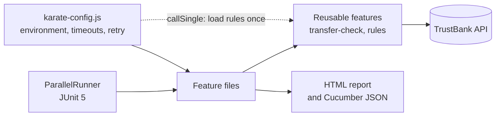

<div align="center">

# 🥋 Karate DSL API Framework

**API tests for TrustBank's transfer rules, written in Karate with no step definitions**

   

[](https://github.com/skamirullah/practiceqa-karate-dsl-api/actions/workflows/ci.yml)  

[What it tests](#-what-it-tests) · [Quick start](#-quick-start) · [How it is built](#-how-it-is-built) · [Structure](#-project-structure) · [Reports](#-reports-and-debugging)

</div>

---

## 👋 Overview

An API automation framework in Karate DSL. Tests are plain feature files with built-in HTTP, JSON matching and parallel execution, so there is no glue code to maintain. It checks the rules a bank applies before money moves.

|  |  |
|---|---|
| **App under test** | [TrustBank API](https://www.practiceqaautomation.com/api-practice): bank rules and the transfer check |
| **Kind of testing** | API, with schema-style matching |
| **Tests** | 17 scenarios |
| **Runs in** | Any machine with Java; the API is the live practice site |

### Highlights

- **No glue code.** Requests, assertions and data all live in the feature files.
- **Rules are read, not typed.** Limits come from the API's own `/rules` endpoint, loaded once per run.
- **Boundary testing.** Approval is checked just below, exactly at, and above the threshold.
- **Polite to the API.** A rate-limited request (429) is retried after a pause instead of failing.

## 🎯 What it tests

| Area | What is checked |
|---|---|
| Rules endpoint | Shape of the response, every account's fields, and that the limits are consistent |
| Allowed transfers | A small transfer passes without approval |
| Approval threshold | Just below, exactly at, and above ₹25,000 |
| Daily limit | At the limit, over it, and including money already sent today |
| Balance | More than a stated balance, and more than the opening balance |
| RTGS | Refused below its minimum amount |
| Missing fields | All reported together in one 422 |
| Malformed requests | Unknown account, unknown mode, negative amount, amount as text |

## 🚀 Quick start

**You need:** Java 17+ and Maven 3.9+.

```bash
git clone https://github.com/skamirullah/practiceqa-karate-dsl-api.git
cd practiceqa-karate-dsl-api
mvn test
```

| Command | What it does |
|---|---|
| `mvn test` | Run every feature in parallel |
| `mvn test -Dkarate.options="--tags @smoke"` | Run only the smoke scenarios |
| `mvn test -Dkarate.env=local` | Test a build on `http://localhost:3000` |
| `mvn test -Dtest=TransferRunner` | Run one feature from its own runner |

## 🧱 How it is built



- **`karate-config.js` owns the environment.** Base URL, timeouts and the retry policy are set in one place and switched with `-Dkarate.env`.
- **`callSingle` for shared data.** The bank's rules are fetched once and shared across all threads.
- **Reusable features.** `transfer-check.feature` is called by every scenario, so the endpoint is defined once.
- **Fuzzy matching.** Markers such as `#number`, `#regex` and `#[3]` check the shape of a response without pinning every value.
- **Features next to runners.** Each package has its own runner for quick runs from an IDE.

## 📁 Project structure

```text
src/test/java
├── karate-config.js                # environment, timeouts, retry, rules loaded once
├── logback-test.xml                # quiet console, full detail in target/karate.log
└── com/practiceqa/bank
    ├── ParallelRunner.java         # runs everything; used by `mvn test`
    ├── common/                     # reusable features: rules, transfer-check
    ├── rules/                      # rules.feature + RulesRunner
    └── transfer/                   # transfer-check.feature + TransferRunner
```

## ⚙️ Configuration

The environment is chosen with `-Dkarate.env` and defined in `karate-config.js`.

| Setting | Default | What it does |
|---|---|---|
| `karate.env` | `prod` | `prod` tests the live site; `local` tests `http://localhost:3000`. |
| `karate.options` | none | Karate options, for example `--tags @smoke`. |
| retry | 7 × 10 s | How long a rate-limited request is retried before failing. |

## 📊 Reports and debugging

- **Karate HTML**: `target/karate-reports/karate-summary.html`, with every request and response.
- **Cucumber JSON** is written alongside it for dashboards and CI plugins.
- **Log**: `target/karate.log` holds the full HTTP detail of the run.

## 🔁 Continuous integration

[GitHub Actions](.github/workflows/ci.yml) runs the features on every push and pull request and uploads the Karate report.

## 🧪 About the app under test

TrustBank's API publishes the bank's limits and validates a transfer with the same rules as the Transfer form in the app. It is stateless: nothing is stored and no money moves, so it is safe to test freely.

[PracticeQAAutomation](https://www.practiceqaautomation.com) is a free practice site for QA engineers, with realistic apps to automate with Selenium, Playwright and Cypress. All data in these tests is fictional.

## 👤 Author

**Sk Amir Ullah** · Technical Lead, SDET and Test Automation

[Portfolio](https://skamirullah.com) · [LinkedIn](https://linkedin.com/in/skamirullah) · [GitHub](https://github.com/skamirullah) · [PracticeQAAutomation](https://www.practiceqaautomation.com)

## 📄 License

[MIT](LICENSE)
